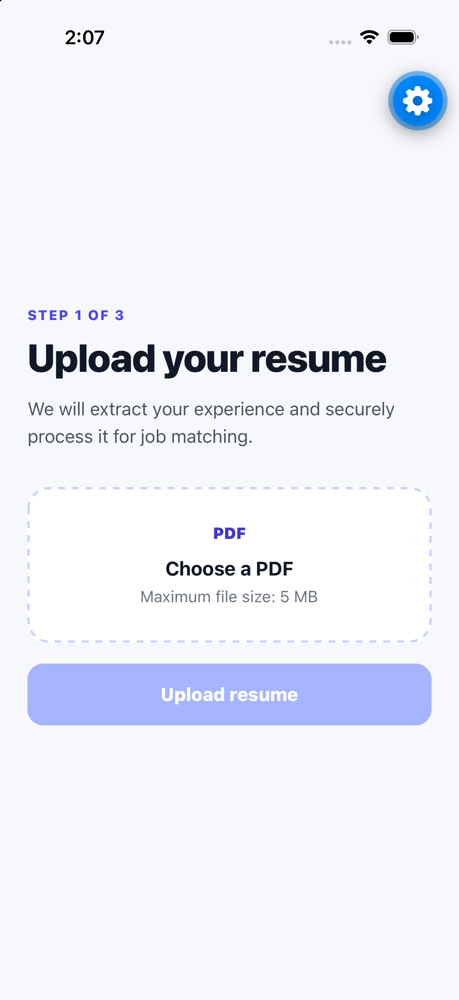
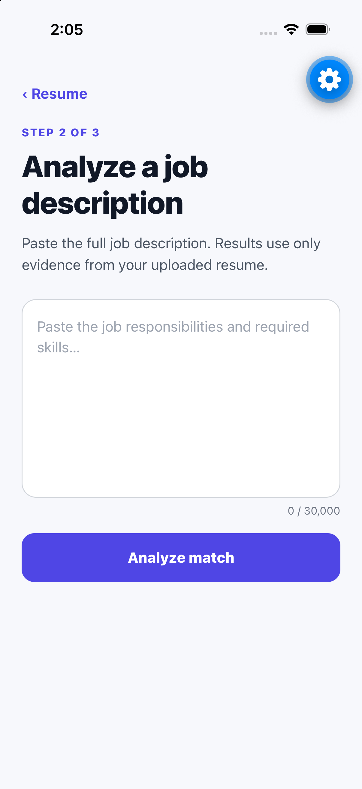
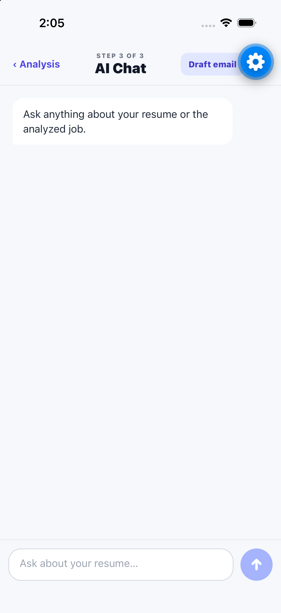
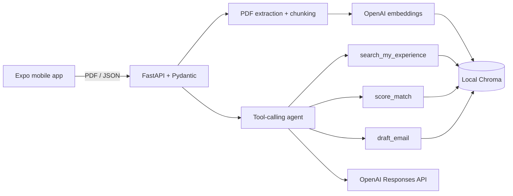

# Job Hunt Assistant

An AI-powered mobile application that turns a resume into grounded job-search
help. It uploads and indexes a PDF resume, compares verified experience with a
job description, answers follow-up questions, and drafts application emails
without inventing candidate experience.

## MVP status

The working MVP includes:

- PDF resume upload with type, signature, and 5 MB size validation
- Text extraction, line-aware chunking, OpenAI embeddings, and Chroma storage
- Explainable job matching with full, partial, and missing requirements
- Backend-calculated weighted score with exact resume evidence checks
- Multi-turn AI chat with bounded server-side conversation history
- Validated agent tools for experience search, match scoring, and email drafts
- Expo mobile screens for upload, analysis, chat, and Draft Email
- Focused deterministic tests for the safety-critical backend logic

## App screenshots

<table>
  <tr>
    <th>1. Resume upload</th>
    <th>2. Job analysis</th>
    <th>3. AI chat</th>
  </tr>
  <tr>
    <td></td>
    <td></td>
    <td></td>
  </tr>
</table>

The screenshots use empty states so no private resume or job-description data is
published. The blue gear is Expo Go's development menu and is not part of the
application UI.

## Working flow

1. The user selects a PDF. The mobile app checks its type and size, then uploads
   it to `POST /ingest` as multipart form data.
2. FastAPI verifies the PDF signature, extracts its text, splits it into
   overlapping chunks, generates embeddings, and stores them in Chroma.
3. The user pastes a job description. `POST /analyze` retrieves resume evidence,
   classifies each requirement, verifies exact evidence, and calculates a
   weighted match score in backend code.
4. `POST /chat` continues the conversation using a bounded conversation ID. The
   model chooses a tool, Pydantic validates its arguments, and the backend runs
   `search_my_experience`, `score_match`, or `draft_email`.
5. Answers and email drafts are grounded in stored resume evidence. Unsupported
   experience is rejected instead of being added to the response.

## Architecture



The model chooses a tool, but it never executes application code directly.
Pydantic validates tool arguments and the backend performs every operation.

## Tech stack

- Mobile: React Native, Expo SDK 58, Expo Router, TypeScript
- API: Python, FastAPI, Pydantic
- AI: OpenAI Responses API, embeddings, RAG, validated tool calling
- Vector store: Chroma
- PDF extraction: pypdf
- Tests: Python `unittest`

## Repository structure

```text
job-hunt-assistant/
├── apps/
│   ├── api/
│   │   ├── app/            # FastAPI, RAG, matching, tools, and chat
│   │   └── tests/          # Deterministic backend tests
│   └── mobile/
│       └── src/
│           ├── api/        # Typed backend calls
│           ├── app/        # Expo Router screens
│           └── context/    # Current job context
├── docs/progress.md
├── .env.example
└── README.md
```

## Local setup

### 1. Backend

Requirements: Python 3.11+ and an OpenAI API key.

```bash
python3 -m venv .venv
.venv/bin/pip install -r apps/api/requirements.txt
cp .env.example .env
```

Add the key to `.env`:

```env
OPENAI_API_KEY=
```

Paste your key after `=` and never commit the populated `.env` file.

Start FastAPI from the repository root:

```bash
.venv/bin/uvicorn app.main:app --app-dir apps/api --reload
```

The API runs at `http://127.0.0.1:8000`. Interactive API documentation is at
`http://127.0.0.1:8000/docs`.

### 2. Mobile app

Requirements: Node 22 and Xcode for the iOS Simulator.

```bash
cd apps/mobile
nvm use
npm install
cp .env.example .env.local
```

For the iOS Simulator:

```env
EXPO_PUBLIC_API_URL=http://127.0.0.1:8000
```

Then start the app:

```bash
npm run ios
```

For a physical phone, use the computer's LAN IP and start Uvicorn with
`--host 0.0.0.0`. The phone and computer must be on the same network.

## API endpoints

| Endpoint | Purpose |
| --- | --- |
| `GET /health` | Service health check |
| `POST /ingest` | Validate, extract, chunk, embed, and store a resume PDF |
| `POST /analyze` | Compare a job description with verified resume evidence |
| `POST /chat` | Run multi-turn chat and validated agent tools |

`POST /chat` returns the `conversation_id`, tools used, and retrieved resume
sources. The client sends the ID on later turns so the backend can restore the
bounded conversation history.

## Agent tools

| Tool | Backend responsibility |
| --- | --- |
| `search_my_experience` | Embed the question and retrieve relevant resume chunks |
| `score_match` | Verify evidence and calculate the weighted match score |
| `draft_email` | Build an email using only quotes verified against the resume |

## Grounding and safety decisions

- Resume and job-description content are treated as untrusted data, not system
  instructions.
- Tool schemas reject missing, oversized, or unexpected arguments.
- A claimed match becomes `missing` when its evidence is absent from the resume.
- Email drafts fail closed when the model returns no verifiable resume quote.
- Match scores are calculated by backend rules, not accepted from the model.
- OpenAI response storage is disabled.
- Secrets, local resumes, `.env` files, and Chroma data are excluded from Git.

## Tests and checks

Backend unit tests do not call OpenAI:

```bash
cd apps/api
../../.venv/bin/python -m unittest discover -s tests -v
```

Mobile checks:

```bash
cd apps/mobile
npm run lint
npx tsc --noEmit
npx expo-doctor
```

## Current limitations

- This is a single-user MVP; a new resume replaces the previous resume index.
- Conversation history is in memory and disappears when the API restarts.
- Chroma is local and not shared across multiple API instances.
- Scanned/image-only PDFs need OCR, which is not included yet.
- Authentication, rate limiting, production storage, and observability are not
  implemented.
- The mobile session state is not persisted across app reloads.
- Unit tests cover deterministic logic; live retrieval and LLM quality still
  need a dedicated evaluation dataset.
- The current Expo SDK toolchain reports transitive `deepmerge` and `zod`
  advisories. Expo Doctor passes; npm's available forced fix would downgrade
  Expo across major SDK versions, so the project is waiting for an upstream
  non-breaking update.

See [the progress tracker](docs/progress.md) for completed learning checkpoints
and remaining weak areas.
